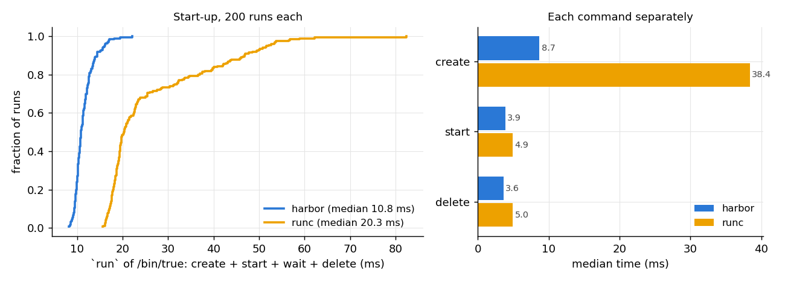

# Harbor

A container runtime written from scratch, with the parts around it needed to run images.

- **Go: the runtime.** An OCI runtime with runc's command line (`create`, `start`, `state`,
  `kill`, `delete`, `run`). It handles:
  - namespaces, cgroups v2, mounts and `pivot_root`, devices;
  - capabilities, rlimits and hooks;
  - seccomp, through a BPF compiler written here (no libseccomp).

  On top of that, image-based containers: an overlayfs root over the image layers, a bridge
  network with NAT, a shim that keeps logs and exit codes, and an HTTP API.
- **Rust: images.** It pulls from public registries (Docker Hub's token flow) into a
  content-addressed store, checking every SHA-256 digest. It unpacks the layers for overlayfs,
  turning whiteouts into overlay whiteouts, and runs a small local registry (Docker Registry
  HTTP API v2) that can be pushed to and pulled from.
- **Python: tests and benchmarks.** Isolation tests, the official OCI validation suite as the
  conformance measure, and start-up and overhead benchmarks against runc.
- **TypeScript: the UI.** It shows the containers, their CPU and memory over time, their logs,
  and lets you run, stop and remove them.

It needs a Linux kernel and root. Everything here was developed and measured in **WSL2**
(Ubuntu 24.04, kernel 6.18), and CI runs it on GitHub's Ubuntu machines.

**Results in brief:**

| | Harbor | runc 1.3.4 |
|---|---|---|
| OCI validation programs passed (runtime-tools, 58 programs) | **38** | 31 |
| OCI validation assertions passed | **98.1%** (3,653 / 3,725) | 96.9% (2,528 / 2,609) |
| start-up (`run` of `/bin/true`, median of 200) | **10.8 ms** | 20.3 ms |
| CPU-bound job inside a container vs the same binaries outside | 4,510 ms vs 4,517 ms | 4,605 ms |
| isolation tests (pid, memory, CPU, pids, filesystem, privileges, network) | 13 / 13 | – |

The CI repeats the whole evaluation on a GitHub Ubuntu 24.04 machine (4 CPUs, cgroup v2), and
the results agree: 38 against 31 programs passed, all 13 isolation tests pass, and start-up is
8.8 ms against 17.7 ms in a short 20-run benchmark.

The 20 programs Harbor fails, runc fails too:

- **16 programs are cgroup tests.** runtime-tools still reads cgroup v1 paths and prints
  "cgroupv2 is not supported yet" on a unified-hierarchy system such as WSL2 or current Ubuntu.
- **4 programs have problems of their own** (see [Conformance](#oci-conformance)).

## How a container starts

`harbor create ID` (in an OCI bundle: `config.json` + `rootfs/`) does the following:

1. It checks the config and creates the cgroup under `/sys/fs/cgroup/harbor/`. It then
   translates the limits written for cgroup v1 (memory, swap, CPU shares and quota, cpuset,
   pids, block-I/O weight) into v2 files.
2. It starts `harbor init` with `clone3` and the configured `CLONE_NEW*` flags. Using
   `CLONE_INTO_CGROUP`, the process starts already inside the cgroup and never runs outside
   its limits. When a config names existing namespaces to join (`linux.namespaces[].path`),
   a C constructor does the `setns(2)` before the Go runtime starts its threads. For a PID
   namespace it forks, and the child becomes the init.
3. For a user namespace, Go writes the uid/gid maps and the init becomes root of the
   namespace before `exec`. Our host uid is usually not mapped, and an unmapped uid would
   `exec` without capabilities.
4. Parent and init talk over two pipes:
   1. the runtime sends the config;
   2. the init reports that its namespaces exist;
   3. the runtime runs the `createRuntime`/`prestart` hooks;
   4. the init sets up the root filesystem and reports "ready", or an error.
5. Inside, the init:
   1. makes `/` a slave mount, so nothing reaches the host;
   2. bind-mounts the rootfs and performs the configured mounts, resolving every destination
      with a symlink-safe join inside the rootfs;
   3. creates the devices;
   4. runs the `createContainer` hooks;
   5. calls `pivot_root(".", ".")` and detaches the old root;
   6. applies the masked and read-only paths, the read-only root, the sysctls, the hostname,
      the rlimits and `oom_score_adj`;
   7. finds the program, so that a wrong `args[0]` fails `create`, not `start`.
6. The init then blocks on `exec.fifo`. It holds a descriptor on the state directory and
   opens the fifo with `openat`, which works through both `pivot_root` and `chroot`.

`harbor start ID` opens the fifo. The init then:

1. runs the `startContainer` hooks;
2. drops privileges in the order that keeps each step possible:
   1. it shrinks the bounding set;
   2. without `no_new_privs`, it loads the seccomp filter while it still holds
      `CAP_SYS_ADMIN`;
   3. it changes groups, gid and uid (keeping capabilities);
   4. it sets the capability sets and the ambient ones;
   5. with `no_new_privs`, it loads the filter now;
3. calls `execve`.

`kill`, `state` and `delete` work from the state saved under `/run/harbor/ID`. A process
counts as alive only while its start time matches the one recorded, so a reused PID is never
mistaken for the container.

### Seccomp without libseccomp

`internal/seccomp` turns `linux.seccomp` into classic BPF. The program:

- checks the architecture;
- refuses x32 calls;
- for each rule, compares the syscall number, then each argument condition.

An argument is 64 bits, but BPF compares 32-bit words, so `==`, `!=`, `>`, `>=`, `<`, `<=` and
masked-equal are built from comparisons of the high word and the low word.

The unit tests run the program in a BPF interpreter (in the test file). They compare every
operator with a reference implementation, on values that straddle the 32-bit boundary. The
syscall table is generated from the kernel headers.

### Image containers

`harbor run-image [-d] [--memory 64m] [--cpus 0.5] [--pids 100] [--net bridge|none|host] IMAGE [CMD]`
does the following:

1. It asks `harbor-registry` for the image (pulling it if needed).
2. It mounts an overlayfs: the image layers are the lower directories (read-only, shared by
   every container of that image), and each container gets its own upper directory.
3. It writes a config with the defaults:
   - pid, network, ipc, uts, mount and cgroup namespaces;
   - Docker's 14 capabilities;
   - `no_new_privs`;
   - masked `/proc` entries;
   - a seccomp profile refusing 43 calls (module loading, `mount`, `unshare`, `setns`, keyrings,
     `bpf`, `perf_event_open`, clocks, `reboot`, ...).
4. For `--net bridge` it connects the container to `harbor0`: a veth pair, an address in
   10.88.0.0/16, a default route and masquerading. Addresses are allocated with one `O_EXCL`
   file each, so two containers never share one.
5. In detached mode a shim process (`harbor _shim`, in its own session) owns the container. It
   timestamps every line of stdout and stderr into `log.jsonl`, waits for the exit and records
   the exit code and the final cgroup statistics.

`ps`, `logs`, `stats`, `stop` (SIGTERM, then SIGKILL after 10 s), `rm` and `inspect` work on
these containers. `harbor serve` offers them as JSON and serves the UI.

## Results

All the measurements were taken in WSL2 on a laptop:

- Intel i7-10870H, 16 threads, 7.7 GB given to WSL;
- Ubuntu 24.04, kernel 6.18.54.1-microsoft-standard-WSL2, cgroup v2 only.

The raw numbers are in `results/` (`oci_harbor.json`, `oci_runc.json`, `bench.json`).

### OCI conformance

The OCI runtime-tools validation suite (commit bd3b0bd) was built from source and run with
`RUNTIME=harbor` and `RUNTIME=runc`. Each of its 58 programs is a small Go program that creates
containers through the runtime's command line and checks the result from inside (with its
`runtimetest` binary) or from outside. They print TAP; `bench/oci_conformance.py` runs them and
counts.

| | programs passed | assertions passed | failed | skipped |
|---|---|---|---|---|
| Harbor | **38 / 58** | **3,653** (98.1%) | 72 | 496 |
| runc 1.3.4 | 31 / 58 | 2,528 (96.9%) | 81 | 341 |

The percentage of assertions depends heavily on a few programs that check every field of the
config: about 270 checks each, in about a dozen programs. The count of programs passed is the
clearer measure.

**Where both fail (20 programs):**

- **16 cgroup programs.** These are `linux_cgroups_*` (14 programs), `delete_resources` and
  `delete_only_create_resources`. The suite looks for cgroup v1 files (`/sys/fs/cgroup/memory/...`)
  and says "cgroupv2 is not supported yet". On a cgroup v2 system no runtime can pass them.
  Harbor's cgroup handling is checked instead by its own isolation tests (below) and unit tests.
- **`pidfile`.** The test kills the container after its process (`true`) has already exited.
  The spec requires `kill` on a stopped container to fail, so both runtimes report an error and
  the test counts it as a failure.
- **`start`.** The last check creates a config without `process` and expects `start` to
  *succeed*, while the spec says it MUST fail.
- **`process_rlimits`.** It fails on `RLIMIT_NOFILE`. Harbor sets the soft limit to 3000 as
  asked, but the checking program is written in Go, and Go raises its own soft limit to the
  hard one at start-up, so it sees 4000.
- **`misc_props`.** Both runtimes fail it too. Harbor rejects the config with
  `ociVersion: "invalid"`, which the test does not expect; we did not pursue it further.

**Where only runc fails (7 programs):**

- `hooks_stdin`: two of the three checks of the state passed to hooks fail. Harbor failed one of
  them too (prestart hooks got "creating" where the test wants "created") until it was changed.
- `process_capabilities_fail`: runc accepts an unknown capability name.
- `linux_devices`, `linux_mount_label`, `linux_process_apparmor_profile`, `linux_seccomp`,
  `mounts`: runc reports an error for something in the test config on this kernel. These were
  not investigated further.

**Found along the way:**

- **`linux_ns_itype`** runs a container with no namespaces at all. runc then mounts `/proc`,
  `/dev`, `/dev/pts`, ... into the **host's** mount namespace and leaves them there: 7 stray
  mounts under `/tmp/ocitest*` after one run.
- **Harbor** does no mounts without a mount namespace; it only uses `chroot`.

**Bugs this suite found in Harbor (all fixed):**

- The exec fifo was created with the umask applied (0600), so a container whose root is
  remapped by a user namespace could not open it. The test runtime said only "stopped, not
  created".
- In a user namespace the init kept our unmapped host uid. It became `nobody` with no
  capabilities, so even `mount --make-rslave /` failed.
- Unknown capability names were found only at `start`; the spec wants them refused at `create`.
- The fifo was opened through `/proc/self/fd`, which does not exist when the container has no
  `/proc`.
- `rootfsPropagation` was applied before the root was bind-mounted, so `unbindable` failed.
- Joining an existing PID namespace was missing. It is now done in the C constructor, with a
  fork.

### Isolation (`tests/test_isolation.py`, 13 tests, all pass)

Each test runs real containers from Alpine or Python images and checks the effect from both
sides:

| what | how it is checked |
|---|---|
| PID namespace | the container sees ≤ 3 processes, with its shell as PID 1; it cannot signal a `sleep` started on the host, which keeps running |
| memory limit | with `--memory 64m`, allocating 200 MB is killed by the OOM killer: exit 137, `oom_kill ≥ 1`, peak ≤ 64 MiB; 20 MB under the same limit works |
| CPU limit | spinning for 3 s with `--cpus 0.5` gets 0.4–0.6 of a core; 2 spinners with `--cpus 1.5` get 1.3–1.65; without a limit they get > 1.75 |
| pids limit | with `--pids 20`, a loop starting 60 processes is refused with EAGAIN before 20 |
| filesystem | a file created on the host is not visible; writes inside go to the container's overlay layer and are visible neither on the host nor in the next container |
| read-only root | `--read-only`: writes to `/` fail |
| kernel files | `/proc/kcore` reads as empty; `/proc/sys` and `/proc/sysrq-trigger` are read-only |
| privileges | `mount`, `unshare -U` and `ip link add` fail; no `CAP_SYS_ADMIN` or `CAP_NET_ADMIN`; `no_new_privs` is set; seccomp is in filter mode |
| user namespace | uid 0 inside is uid 100000 on the host (read from `/proc/PID/status` outside) |
| network | `--net none`: only `lo`, and the internet is unreachable; bridge: a container reaches another's HTTP server by its 10.88.x address, and so does the host |

### Start-up and overhead (`bench/startup.py`)

The same bundle for both runtimes:

- an Alpine rootfs;
- the config from `harbor spec`: pid/net/ipc/uts/mount/cgroup namespaces, a seccomp profile,
  14 capabilities, masked paths.



| | Harbor | runc |
|---|---|---|
| `run` (create + start + wait + delete) of `/bin/true`, median of 200 | **10.8 ms** (p10 9.4, p90 14.4) | 20.3 ms (p10 17.2, p90 46.8) |
| `create` alone | 8.7 ms | 38.4 ms |
| `start` alone | 3.9 ms | 4.9 ms |
| `delete` alone | 3.6 ms | 5.0 ms |

- **Why Harbor starts faster.** It execs itself once for the init, and the init is a plain Go
  program. runc re-executes through its C `nsexec` stage, with extra processes and a sync
  protocol, and it is more thorough in ways Harbor is not: cgroup device programs, AppArmor,
  checks against hostile rootfs.
- **runc's `create` alone (38 ms) is slower than its whole `run` (20 ms).** We measured this
  but did not look into why.

Image containers, `harbor run-image --rm alpine:3.20 true` (overlay mount, config, init, cleanup),
median of 40:

| network | time |
|---|---|
| `--net none` | 27.9 ms |
| bridge | 179.8 ms |

The bridge setup is about ten `ip`/`nsenter` commands (veth pair, moving the peer, addresses,
routes, NAT check). Doing it over netlink in-process would remove most of that.

The cost of running inside a container, as the median of 5:

| job | same binaries, chroot on the host | Harbor | runc |
|---|---|---|---|
| busybox `sha256sum` of 256 MB (CPU-bound) | 4,517 ms | 4,510 ms | 4,605 ms |
| 500 `fork+exec` of `/bin/true` | 216 ms | 235 ms | 272 ms |

- **CPU-bound work:** no measurable overhead; the seccomp filter and cgroups cost nothing
  visible.
- **The fork loop:** the container times include each runtime's own start-up (about 11 and
  20 ms). The rest of the difference is the seccomp filter, which every `execve` and `clone` in
  the loop passes through.

### The UI

`harbor serve --web web/dist` shows:

- **The containers:** status, image, address, memory.
- **For a selected container:**
  - tiles with uptime, memory used, peak and limit, the CPU quota with time used and throttled,
    processes, OOM kills and the network;
  - CPU and memory charts over the last 5 minutes (sampled every 2 s, with the limit drawn);
  - the logs, followed live, with stderr marked.
- **Controls:** a form runs a new container (image, command, memory, CPUs, pids, network), and
  any container can be stopped or removed.

The API accepts changes only as JSON with an `X-Harbor: 1` header, so a page on another origin
cannot trigger them. It listens on 127.0.0.1, which WSL forwards to Windows.

## What is not supported

- `process.terminal` / `--console-socket`.
- Joining an existing user namespace.
- The time namespace.
- cgroup v1 (only the unified hierarchy).
- systemd-style `cgroupsPath`.
- Device rules in cgroup v2, which would need an eBPF device program; `linux.resources.devices`
  is ignored.
- AppArmor and SELinux labels (accepted and ignored).
- `process.user.username`.
- Image layers compressed with zstd.
- The network is one bridge with NAT: no published ports, no IPv6, no DNS between containers.
- Images are pulled for linux/amd64 only, anonymously, so private repositories are not
  supported.

## External code

The project's rule is to use no third-party binaries or test suites unless they are allowed
explicitly. For this project two were allowed, for the evaluation only:

- **runc** (Ubuntu's package, 1.3.4), as the baseline;
- the **OCI runtime-tools** validation suite, built from source
  (github.com/opencontainers/runtime-tools), as the conformance measure.

Neither is used by Harbor itself.

Harbor uses some libraries and system tools:

- **Libraries:** the OCI spec's Go types (`github.com/opencontainers/runtime-spec`),
  `golang.org/x/sys`, and the usual Rust crates (serde, sha2, flate2, tar, ureq, libc).
- **System tools:** `ip`, `iptables` and `nsenter` from the host, for the bridge network only.

The images (Alpine, Debian, Python) are pulled from Docker Hub when they are first used.

## Build and run

In Linux (WSL2: `wsl -d Ubuntu-24.04 -u root`), with Go ≥ 1.22, Rust, gcc, iproute2, iptables:

```bash
(cd runtime && go build -o /usr/local/bin/harbor ./cmd/harbor)
cargo build --release --manifest-path registry/Cargo.toml
install -m755 registry/target/release/harbor-registry /usr/local/bin/
(cd web && npm ci && npm run build)          # the UI (Node.js; can be built on Windows too)

harbor pull alpine:3.20
harbor run-image --rm --memory 64m --cpus 0.5 alpine:3.20 sh -c 'cat /sys/fs/cgroup/memory.max'
harbor run-image -d --name web python:3.12-alpine python3 -m http.server 8080
harbor ps; harbor logs web; harbor stats web; harbor rm -f web
harbor serve --web web/dist                  # UI on http://127.0.0.1:8800 (also reachable from Windows)
```

As an OCI runtime:

```bash
mkdir -p bundle/rootfs && cd bundle
cp -a "$(harbor-registry inspect alpine:3.20 | python3 -c 'import json,sys;print(json.load(sys.stdin)["layers"][0])')"/. rootfs/
harbor spec                       # writes a default config.json
harbor run demo                   # or: harbor create demo; harbor start demo; harbor state demo; harbor delete demo
```

The tests and the evaluation:

```bash
(cd runtime && go test ./...)
cargo test --manifest-path registry/Cargo.toml
(cd web && npm test)
python3 -m pytest tests -q                                   # isolation tests (root)
git clone https://github.com/opencontainers/runtime-tools /opt/oci/runtime-tools
(cd /opt/oci/runtime-tools && make runtimetest validation-executables)
python3 bench/oci_conformance.py --runtime harbor --out results/oci_harbor.json
python3 bench/oci_conformance.py --runtime runc   --out results/oci_runc.json
python3 bench/startup.py --out results/bench.json && python3 bench/plots.py results/bench.json results/startup.png
```

## Layout

```
runtime/cmd/harbor        CLI
runtime/internal/container   OCI operations, init, rootfs, capabilities, hooks, state
runtime/internal/cgroups     cgroup v2: limits, stats, removal
runtime/internal/seccomp     BPF compiler (+ generated syscall table)
runtime/internal/nsenter     setns before the Go runtime starts (cgo)
runtime/internal/image       image containers: overlayfs, network, shim, logs, API
registry/                 harbor-registry (Rust): pull, push, store, unpack, registry server
tests/                    isolation tests (pytest)
bench/                    OCI conformance runner, start-up/overhead benchmark, plots
web/                      UI (TypeScript, Vite)
results/                  measured results
```

## License

MIT
